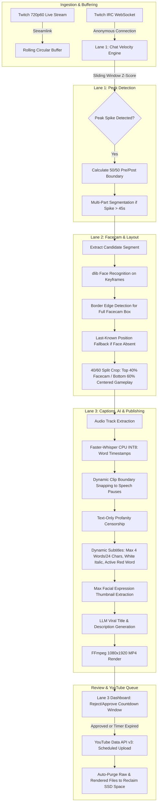

# AutoClipper: Complete System Technical Specification & Blueprint

## 1. Project Overview & Operational Goal
**AutoClipper** is an autonomous, real-time video clipping, editing, and publishing pipeline engineered for live Twitch streaming (optimized specifically for Kai Cenat). It continuously monitors ongoing live broadcasts, evaluates real-time chat velocity to isolate peak hype moments, segments long hype sequences into coherent dynamic multi-part clips (max 45s each without mid-speech cuts), isolates the facecam overlay and gameplay regions using computer vision, renders a 9:16 vertical video (40/60 split), burns in dynamic red-accented karaoke subtitles with text censorship, extracts viral thumbnails based on facial expression intensity, generates AI viral titles/descriptions, and schedules the clips for YouTube Shorts publishing within an auto-queue featuring a manual Reject/Approve grace period.

The system is optimized for background execution on Windows ARM64 (Qualcomm Snapdragon X Plus - CPU only) inside Docker, featuring an interactive 3-lane visual dashboard built in Vite/React and FastAPI.

---

## 2. End-to-End Pipeline Workflow



---

## 3. Detailed Component Specifications

### 3.1. Stream & Chat Ingestion
- **Stream Ingestion**:
  - Source: `https://twitch.tv/kaicenat` captured via `streamlink` at **720p60** (`720p60,720p,best`).
  - Storage: Circular disk buffer maintaining the latest 5 minutes of footage in rolling `.ts` chunks (discarding segments older than 5 minutes until a clip is triggered).
- **Chat Ingestion**:
  - Direct connection to Twitch IRC WebSocket (`wss://irc-ws.chat.twitch.tv:443`).
  - Anonymous read-only join (`NICK justinfan12345`, `JOIN #kaicenat`).
  - Zero API rate limits or authentication tokens required for chat monitoring.

### 3.2. Lane 1: Peak Moment Detection & Dynamic Slicing
- **Velocity Algorithm**:
  - Sliding time window (5-second buckets) tracking message frequency $V_t$.
  - Continuous calculation of rolling baseline $\mu_{rolling}$ and standard deviation $\sigma_{rolling}$ over 3 minutes.
  - Spike trigger when $V_t > \mu + 2.5 \cdot \sigma$ (pure velocity & density driven, allowing maximum natural event variety).
- **50/50 Context Ratio**:
  - Candidate clip centered around the peak spike moment $T_{peak}$ with approximately 50% context before and 50% reaction after.
- **Dynamic Duration & Mid-Speech Cut Prevention**:
  - Maximum clip length: **45 seconds**.
  - Audio transcript inspection via word timings: Slices the start and end timestamps at natural sentence boundaries or pauses ($>0.3\text{s}$ silence), guaranteeing no abrupt cutoffs mid-sentence or mid-word.
- **Extended Spike Multi-Part Handling**:
  - When sustained hype/spikes exceed 45 seconds (e.g., 2–3 minutes of chaos), the pipeline automatically splits the sequence into consecutive **Part 1, Part 2, Part 3...** clips (each max 45s), queueing them in sequential posting order.

### 3.3. Lane 2: Computer Vision & 40/60 Layout Engine
- **Facecam Box Detection**:
  - Runs `face_recognition.face_locations` (dlib HOG model) across 5 sampled keyframes.
  - Harsh boundary detection: Identifies the rectangular borders of Kai's facecam box overlay by inspecting high-contrast edge gradients around the detected face centroid.
  - Auto-expands the crop box to encompass the **entire facecam area** rather than just a tight face crop.
- **Absence & Persistence Fallback**:
  - The system saves the coordinates of the active facecam bounding box.
  - If Kai stands up, jumps, or temporarily walks out of frame, the pipeline locks onto and maintains the **last known facecam position**, keeping the stream's camera angle consistent even with an empty chair.
- **Gameplay Framing & Aspect Ratio Split**:
  - Canvas: 9:16 vertical standard ($1080 \times 1920$).
  - **Top 40% ($1080 \times 768$)**: Extracted full facecam frame scaled/cropped to fit.
  - **Bottom 60% ($1080 \times 1152$)**: Gameplay window.
    - Non-overlapping layout: The gameplay region excludes the area covered by the facecam.
    - Horizontal auto-centering: If the remaining gameplay window is 80% width, it is centered with equal left and right margins to keep the core action in focus.

### 3.4. Lane 3: Audio Transcription, Captions & Metadata
- **Speech-to-Text (`Kini218/speech-to-text` / Faster-Whisper CPU)**:
  - INT8 quantized `base.en` / `small.en` running natively on Snapdragon X Plus ARM64 CPU.
  - Emits word-level timestamps: `{word, start, end, confidence}`.
- **Dynamic Captions & Styling Rules**:
  - Layout constraint: **Maximum 4 words per line** and **no more than 24 characters per line**.
  - Font styling: **Italicized high-impact sans-serif** (e.g., Montserrat Italic / Arial Italic bold).
  - Color palette: Default **White** (`#FFFFFF`) with a black outline and subtle drop-shadow.
  - Spoken word accent: Currently active spoken word illuminates in **Vibrant Red** (`#FF1E1E` or `#E50914`).
  - Positioning: Centered horizontally at the lower third of the facecam split or upper third of gameplay ($Y \approx 820$).
- **Censorship Rule**:
  - **Text only**: Profanity / advertiser-sensitive terms (e.g., vulgarities, slurs) are sanitized in the burned subtitles with asterisks (e.g., `f***`, `b****`, `n****`).
  - **Audio raw**: Stream audio remains 100% untouched and unbleeped.
- **Thumbnail Engine (Maximum Facial Expression)**:
  - Analyzes facial landmark distortion (mouth open ratio, eye expansion, eyebrow raise) across peak frames using dlib landmarks.
  - Automatically captures the single frame containing Kai's most exaggerated expression during the clip and saves it as the custom video thumbnail (`thumbnail.jpg`).
- **AI Title & Description Generation (Option B)**:
  - Generates viral, high-CTR YouTube Shorts titles and descriptions based on the spoken words + chat context.
  - Includes auto-hashtags: `#shorts #kaicenat #twitch #gaming #viral`.

### 3.5. YouTube Scheduling, Review Window & Auto-Purge
- **Auto-Queue with "Reject / Approve" Window**:
  - Upon rendering completion, the clip enters the dashboard queue with a configurable countdown timer (e.g., 10 minutes).
  - If approved manually: Queues immediately for the target schedule slot.
  - If rejected: Removed from queue and discarded.
  - If untouched before the countdown expires: Automatically approved and scheduled.
- **Posting Time Optimization**:
  - Dispatches uploads into optimal YouTube audience activity windows:
    - Slot 1: 12:00 PM – 1:30 PM
    - Slot 2: 3:00 PM – 5:00 PM
    - Slot 3: 7:00 PM – 9:00 PM
  - Uses YouTube Data API v3 `status.publishAt` ISO-8601 timestamps.
- **Disk Storage Auto-Purge**:
  - Once a clip is successfully delivered and uploaded to YouTube, the pipeline immediately purges:
    1. The raw `.ts` stream segments associated with the clip.
    2. The rendered intermediate MP4 files and subtitle caches.
    3. Intermediate audio files and thumbnail buffers.
  - Keeps local disk usage near zero so your laptop never runs out of storage.

---

## 4. Visual Experience & UI Design: Functional 3-Column + Dedicated Preview Page

### UI Philosophy
- **Raw, Utilitarian & Functional**: Zero distracting animations, zero floating or decorative text. Clean, high-density, terminal-like information hierarchy focused on actionable data and system state.
- **Two-View Architecture**:
  1. **Main Process Dashboard (3 Columns)**:
     - Real-time monitoring of the 3 active pipeline processes simultaneously.
     - Live logs, metrics, frame bounds, and status indicators.
  2. **Dedicated Preview & Delivery Page (`/preview/:clip_id`)**:
     - Accessible once all 3 processes complete successfully (`STATUS: OK`).
     - Embedded vertical video player (1080x1920 preview).
     - Direct Download button (MP4).
     - Review actions: Manual "Approve & Upload Now", "Reject / Discard", or Countdown to Scheduled Time.
     - Metadata review: Title, description, tags, custom thumbnail preview.

```
┌────────────────────────────────────────────────────────────────────────────────────────────────────────┐
│ AUTOCLIPPER | TARGET: kaicenat | STREAM: 720p60 (LIVE) | CPU: 24% | DISK BUFFER: 142MB | AI: 2/30      │
├────────────────────────────────┬───────────────────────────────┬───────────────────────────────────────┤
│ COLUMN 1: PEAK DETECTION       │ COLUMN 2: FACECAM & FRAMING   │ COLUMN 3: SPEECH & RENDERING          │
├────────────────────────────────┼───────────────────────────────┼───────────────────────────────────────┤
│ STATUS: MONITORING             │ STATUS: IDLE / READY          │ STATUS: IDLE / READY                  │
│                                │                               │                                       │
│ • Message Velocity: 48 msgs/s  │ • Detected Box: (120,40,320,240│ • Audio Track: 16kHz mono WAV        │
│ • Rolling Baseline: 18 msgs/s  │ • Edge Confidence: 94%        │ • Whisper Model: base.en (CPU INT8)   │
│ • Z-Score: 2.82 [TRIGGER]      │ • Last Known Lock: ENABLED    │ • Words Transcribed: 42 words         │
│ • Window: 42.4s (snapped)      │ • Top 40% Res: 1080x768       │ • Censored Words: 2 masked            │
│ • Spike Time: 14:28:11         │ • Bot 60% Res: 1080x1152      │ • FFmpeg Exit: CODE 0 (OK)            │
│                                │ • Face Margin: X=48, Y=24     │ • Render Time: 18.4s                  │
│ --- CHAT LOG (LAST 5) ---      │                               │                                       │
│ [14:28:09] user1: W W W        │ --- FRAME CROPPING LOG ---    │ --- TRANSCRIPTION LOG ---             │
│ [14:28:10] user2: AINT NO WAY  │ [CV2] Face centered at (240,180│ [00:12.1 - 00:13.4] "BRO YOU SAW THAT"│
│ [14:28:10] user3: LMAOOOO      │ [CV2] Expanded to border crop │ [00:13.5 - 00:15.0] "NO F***ING WAY"  │
│ [14:28:11] user4: CLIP THAT    │ [FFMPEG] VSTACK filter ready  │ [00:15.1 - 00:16.8] "HE CRASHED OUT"  │
│                                │                               │                                       │
├────────────────────────────────┴───────────────────────────────┴───────────────────────────────────────┤
│  >>> ALL 3 PROCESSES OK: [ VIEW CLIP #12 IN PREVIEW & UPLOAD PAGE -> ]                                │
└────────────────────────────────────────────────────────────────────────────────────────────────────────┘
```

---

## 5. Dedicated Preview & Delivery Page Layout (`/preview/:clip_id`)

```
┌────────────────────────────────────────────────────────────────────────────────────────────────────────┐
│ [ <- Back to Process Dashboard ]                       CLIP #12 PREVIEW & UPLOAD                       │
├───────────────────────────────────┬────────────────────────────────────────────────────────────────────┤
│ 9:16 VERTICAL PLAYER (1080x1920)  │ METADATA & PUBLISHING ACTIONS                                      │
├───────────────────────────────────┼────────────────────────────────────────────────────────────────────┤
│ ┌───────────────────────────────┐ │ • Title: KAI CENAT CAN'T BELIEVE THIS MOMENT 💀 #shorts            │
│ │                               │ │ • Target Window: 15:30 EST (Optimal Engagement Slot)              │
│ │       [TOP 40% FACECAM]       │ │ • Countdown to Auto-Upload: 08:24 remaining                        │
│ │                               │ │ • File Size: 18.2 MB | Duration: 41.8s | FPS: 60                  │
│ │    "BRO YOU SAW THAT?!"       │ │ • Thumbnail: Selected Frame #412 (Max Facial Distortion)          │
│ │                               │ │                                                                    │
│ │                               │ │ [ ▶ PLAY CLIP ]                                                    │
│ │      [BOTTOM 60% GAMEPLAY]    │ │ [ ⬇ DOWNLOAD MP4 ]                                                 │
│ │                               │ │                                                                    │
│ │                               │ │ [ ✅ APPROVE & SCHEDULE UPLOAD ]                                   │
│ │                               │ │ [ 🚀 UPLOAD IMMEDIATELY (BYPASS SCHEDULE) ]                         │
│ │                               │ │ [ ❌ REJECT & PURGE CLIP ]                                         │
│ └───────────────────────────────┘ │                                                                    │
└───────────────────────────────────┴────────────────────────────────────────────────────────────────────┘
```

---

## 6. Docker Configuration & Snapdragon X Plus Compatibility

- **ARM64 Native Architecture**:
  - Base Image: `python:3.11-slim-bookworm` (Official Debian ARM64 build).
  - Pre-built binary dependencies: `cmake`, `libopenblas-dev`, `liblapack-dev`, `ffmpeg`.
  - Avoids x86 emulation overhead on Windows on ARM.
- **Resource Constraints**:
  - Memory limit: 4GB max memory allocation for the container.
  - Multi-threaded CPU worker configured for Snapdragon X efficiency cores.
- **Docker Compose Volumes**:
  - `autoclipper_buffer`: Fast temporary directory for rolling `.ts` stream segments (auto-purged).
  - `autoclipper_config`: Persistent OAuth credentials, channel configurations, and schedule queues.
